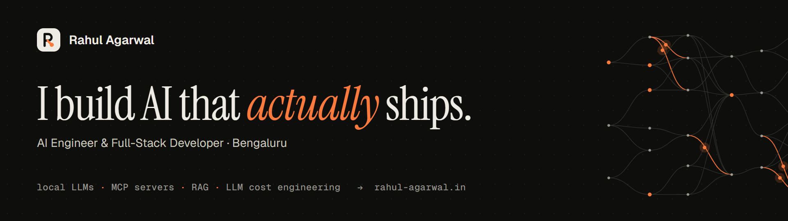
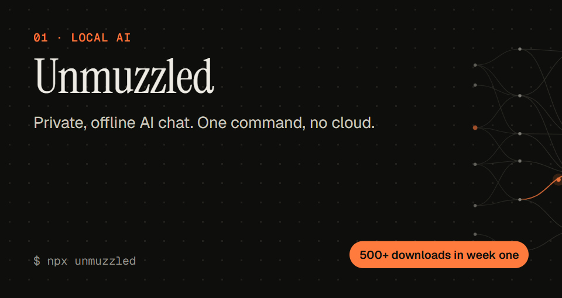
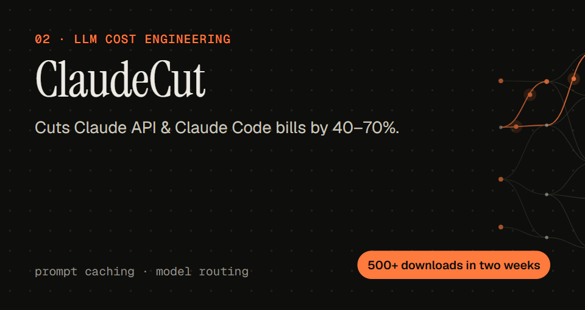
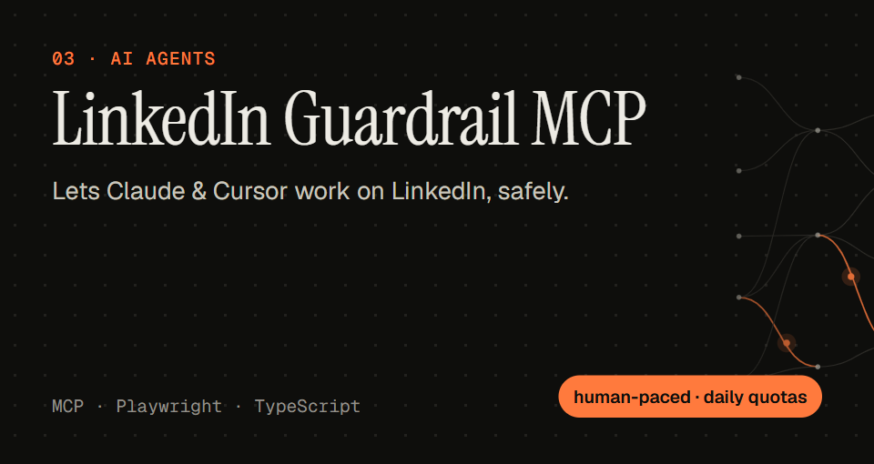
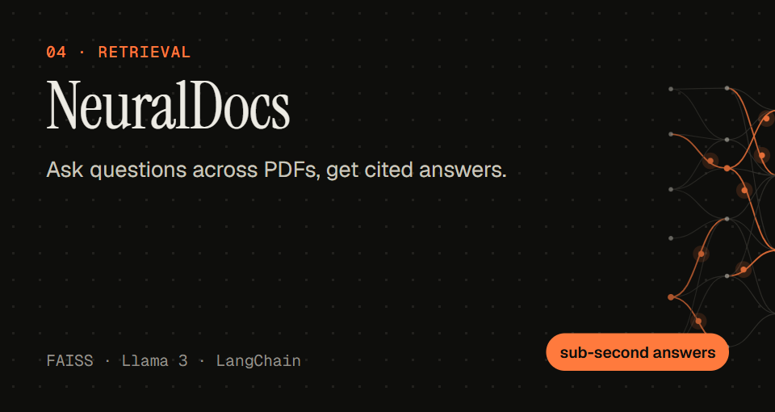
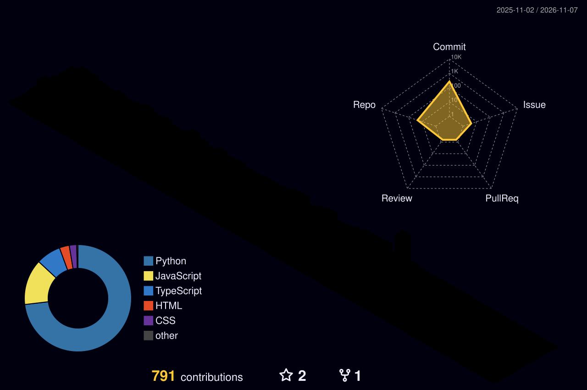

<p align="center">
  <a href="https://www.rahul-agarwal.in">
    
  </a>
</p>

<p align="center">
  <a href="https://www.rahul-agarwal.in">
    
  </a>
</p>

<p align="center">
  <a href="https://www.rahul-agarwal.in"></a>
  <a href="https://linkedin.com/in/rahul-agarwal-ai"></a>
  <a href="https://dev.to/rahul_agarwal18"></a>
  <a href="https://www.npmjs.com/~rahulagarwal18"></a>
  <a href="mailto:rahulagaral1@gmail.com"></a>
</p>

<p align="center">
  
  
  
  
</p>

## Hi, I'm Rahul 👋

I'm an **AI engineer and full-stack developer in Bengaluru**. I turn large language models into products people actually use, from offline inference on a laptop to MCP servers for AI agents and the systems a business runs on every day.

- 💼 **Now:** AI Engineer & Full-Stack Developer at **Aryan News Agency**, sole engineer for the company's web platform and in-house accounting system.
- 🧪 **Before:** Founder's Intern & Full-Stack Developer at **InferWorks**, building LLM agents that cut query turnaround by ~60%.
- 🏆 **Recognition:** UN Millennium Fellow (2025–26) · National Science Day, 1st place 2025 and 2nd place 2024.
- 🎓 **Education:** BCA, CHRIST (Deemed to be University), Bengaluru.
- ⚡ **Fun fact:** my [portfolio](https://www.rahul-agarwal.in) runs a real LLM in your browser, on your GPU. No server.

## 🚀 What I'm shipping

<table>
  <tr>
    <td width="50%" valign="top">
      <a href="https://github.com/rahulagarwal18/unmuzzled"></a>
      <p align="center"><a href="https://github.com/rahulagarwal18/unmuzzled">Code</a> · <a href="https://www.npmjs.com/package/unmuzzled">npm</a> · <a href="https://dev.to/rahul_agarwal18/i-built-a-private-offline-ai-chat-you-can-run-with-one-command-npx-unmuzzled-1bl">Write-up</a></p>
    </td>
    <td width="50%" valign="top">
      <a href="https://github.com/rahulagarwal18/ClaudeCut"></a>
      <p align="center"><a href="https://github.com/rahulagarwal18/ClaudeCut">Code</a> · <a href="https://www.npmjs.com/package/claudecut">npm</a> · <a href="https://dev.to/rahul_agarwal18/how-i-legally-slashed-anthropic-claude-api-claude-code-bills-by-70-19b4">Write-up</a></p>
    </td>
  </tr>
  <tr>
    <td width="50%" valign="top">
      <a href="https://github.com/rahulagarwal18/Linkedin_MCP"></a>
      <p align="center"><a href="https://github.com/rahulagarwal18/Linkedin_MCP">Code</a> · <a href="https://dev.to/rahul_agarwal18/how-i-built-a-safe-anti-ban-linkedin-mcp-server-for-ai-agents-claude-cursor-15o0">Write-up</a></p>
    </td>
    <td width="50%" valign="top">
      <a href="https://github.com/rahulagarwal18/NeuralDocs"></a>
      <p align="center"><a href="https://github.com/rahulagarwal18/NeuralDocs">Code</a></p>
    </td>
  </tr>
</table>

<details>
<summary><b>🧩 More builds (10)</b></summary>
<br />

| Project | Description |
|---|---|
| [GitPulse](https://github.com/rahulagarwal18/gitpulse) · [live](https://rahulagarwal18.github.io/gitpulse/) | Turns GitHub history into an animated, cinematic developer universe |
| [Campus 360 View](https://github.com/rahulagarwal18/yprstreetview) · [live](https://rahulagarwal18.github.io/yprstreetview/) | Interactive 360° campus navigation guide. National Science Day 2025, 1st place |
| [TicketSlayer AI](https://github.com/rahulagarwal18/TicketSlayerAI) | Slack agent that turns messy support chats into clean GitHub Issues with Llama 3 |
| [AI Resume Screener](https://github.com/rahulagarwal18/ai-resume-screener) · [live](https://ai-resume-screener-gules.vercel.app) | Ranks resumes against a job description with embeddings and gap analysis |
| [ReconcileAI](https://github.com/rahulagarwal18/parsing) · [live](https://parsing-phi.vercel.app) | Compares PDFs against spreadsheet records with LlamaParse and Gemini |
| [DeepDecompile](https://github.com/rahulagarwal18/deep-decompile) | Turns minified production bundles back into readable TypeScript and React |
| [OMR Scanner](https://github.com/rahulagarwal18/omrscanner) | Real-time bubble-sheet grading with OpenCV from a live camera feed |
| [Face Recognition Attendance](https://github.com/rahulagarwal18/Automation-Project-) | Real-time face identification and attendance logging with OpenCV and Flask |
| [GlassHUD](https://github.com/rahulagarwal18/glasshud) | Visual glassmorphism CSS builder |
| [Passion Pilot](https://github.com/rahulagarwal18/passion-pilot) · [live](https://passion-pilot-three.vercel.app) | AI roadmap generator for learning any hobby (DEV.to hackathon) |

</details>

## 🛠️ Tech stack

<p align="center">
  
  <br />
  
</p>

<p align="center">
  <b>AI &amp; LLMs:</b> LLM agents · MCP · RAG · LangChain · FAISS · embeddings · Claude API · OpenAI API · Llama 3 on Groq · llama.cpp · WebGPU / WebLLM
</p>

## ✍️ Latest writing

<!-- BLOG-POST-LIST:START -->
- [I put a real LLM in my portfolio. It runs on your GPU, not my server.](https://dev.to/rahul_agarwal18/i-put-a-real-llm-in-my-portfolio-it-runs-on-your-gpu-not-my-server-1cj8)
- [I built a private, offline AI chat you can run with one command: npx unmuzzled](https://dev.to/rahul_agarwal18/i-built-a-private-offline-ai-chat-you-can-run-with-one-command-npx-unmuzzled-1bl)
- [How I Built a Safe, Anti-Ban LinkedIn MCP Server for AI Agents &lpar;Claude &amp; Cursor&rpar;](https://dev.to/rahul_agarwal18/how-i-built-a-safe-anti-ban-linkedin-mcp-server-for-ai-agents-claude-cursor-15o0)
- [OKF vs RAG: Why RAG Alone is Failing Enterprise AI Agents &lpar;And What&#39;s Next&rpar;](https://dev.to/rahul_agarwal18/okf-vs-rag-why-rag-alone-is-failing-enterprise-ai-agents-and-whats-next-2d34)
- [How I Legally Slashed Anthropic Claude API &amp; Claude Code Bills by 70%](https://dev.to/rahul_agarwal18/how-i-legally-slashed-anthropic-claude-api-claude-code-bills-by-70-19b4)
<!-- BLOG-POST-LIST:END -->

## 📟 Résumé in your terminal

```bash
npx rahulagarwal18
```

## 📊 GitHub stats

<p align="center">
  
  
</p>

<p align="center">
  
</p>

<p align="center">
  <a href="https://github.com/ryo-ma/github-profile-trophy"></a>
</p>

## 🐍 Contribution snake

<p align="center">
  <picture>
    <source media="(prefers-color-scheme: dark)" srcset="https://raw.githubusercontent.com/rahulagarwal18/rahulagarwal18/output/github-contribution-grid-snake-dark.svg" />
    <source media="(prefers-color-scheme: light)" srcset="https://raw.githubusercontent.com/rahulagarwal18/rahulagarwal18/output/github-contribution-grid-snake.svg" />
    
  </picture>
</p>

## 🏙️ 3D contribution city

<p align="center">
  
</p>

<p align="center">
  <a href="https://www.youtube.com/watch?v=bc0KhhjJP98"></a>
</p>

<p align="center"><i>Open to AI engineering and full-stack roles · <a href="mailto:rahulagaral1@gmail.com">rahulagaral1@gmail.com</a></i></p>
